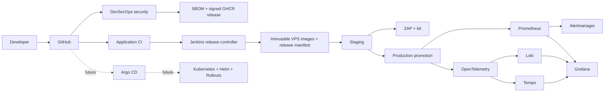

# Target architecture

Current production remains Docker/Terraform/Nginx on the shared VPS. The future Kubernetes path is code-complete infrastructure definition, not an assertion that a cluster is already running.
