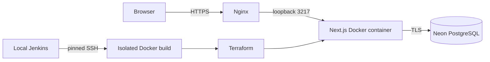

# Architecture

The Next.js App Router serves the React interface and JSON APIs from one Node.js process. Zod validates requests; reusable authentication and error handling guard API routes. Prisma uses the PostgreSQL driver adapter with certificate verification. Neon stores all personal records in the dedicated `life_planning` schema.

`Entry` holds shared planning fields (title, status, dates, priority, progress, category, tags, notes) and kind-specific validated details. Self-relations connect goals, projects, milestones, and subtasks. Financial records, habit logs, study sessions, daily plans, users, sessions, and login audits have separate tables and indexes. Every personal-data query is scoped to the authenticated user.

The first version has one bootstrapped owner with architecture for additional isolated users. There is no public signup. Opaque session tokens are stored only as keyed digests in the database and can be revoked. Password changes invalidate sessions. The first owner password must be changed before modifying plans.

Date-only records use ISO calendar dates, interpreted in the user's timezone. Timestamps are database instants. Monetary values use PostgreSQL decimal columns; summaries group by currency. Recurrence completion and hierarchy edits use transactions and advisory locks to preserve concurrency invariants.

The original ZIP was inspected as inspiration. This implementation replaces its browser-local persistence with owned database records and migrations. No existing reference data is automatically imported.

## Operational boundaries

The shared VPS has approximately 6 GB RAM and many existing applications. Installing a Kubernetes control plane or permanent Jenkins controller there would consume scarce memory and alter shared networking. Production therefore runs Docker directly. Kubernetes YAML is optional future infrastructure, not an active cluster.

Only `/opt/life-planning`, its Docker resources, its own Nginx vhost, and its own certificate are managed by this project. Existing databases, containers, firewall rules, and unrelated application directories are outside its deployment scope.
